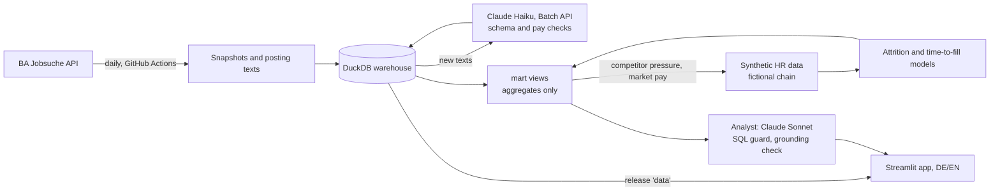

# Schichtwechsel

**Wettbewerb und Belegschaft im Drogeriehandel.** Wer sucht wo Personal, was wird geboten, und wer aus der eigenen Belegschaft geht als Nächstes?

**Live:** https://schichtwechsel.streamlit.app (Deutsch und Englisch; der Analyse-Assistent ist mit einem Zugangscode geschützt, den ich auf Anfrage gern teile)

> Unabhängiges Portfolioprojekt. Keine Verbindung zu den genannten Unternehmen. Die Stellendaten sind echt und öffentlich, die Personaldaten sind synthetisch und beschreiben eine erfundene Kette.

[English version below](#english)

*Schichtwechsel* ist im Filialgeschäft Alltag. Teuer wird es, wenn Mitarbeitende nicht die Schicht wechseln, sondern den Arbeitgeber. Das Projekt verbindet beide Seiten: den Stellenmarkt der Wettbewerber, täglich erfasst, und ein internes Personalmodell, in dem dieser Wettbewerbsdruck das Abgangsrisiko mitbestimmt.

## Was es macht

1. **Wettbewerbsradar.** Täglich alle Stellenanzeigen von dm, Rossmann, Müller, Budni, Lidl, Aldi und Kaufland aus der Jobsuche der Bundesagentur für Arbeit (rund 27.700 offene Stellen). Daraus: Wettbewerbsdruck je Bundesland, Stellen je Filiale, Ausbildungsanteil.
2. **Felder aus Anzeigentexten.** Claude liest Gehalt, Stunden, Vertragsart, Tarifbezug und 16 Benefit-Arten aus den Texten. Geprüft gegen handgelabelte Anzeigen, die das Modell nie gesehen hat: 90 bis 100 % Genauigkeit bei den meisten Feldern.
3. **Internes Personalmodell.** Eine synthetische Kette mit 300 Filialen, monatliche Abgangswahrscheinlichkeit (Survival-Modell) und Besetzungsdauer, mit Modellkarten und einer Fairness-Prüfung nach Altersgruppen.
4. **Analyse-Assistent.** Fragen auf Deutsch oder Englisch; der Assistent fragt die Daten per SQL ab, und jede Zahl in der Antwort wird gegen die Abfrageergebnisse geprüft.

Die wichtigsten Ergebnisse stehen in [docs/befunde.md](docs/befunde.md).

## Ergebnisse auf einen Blick

- Der Druck auf Filialpersonal ist im Südwesten am höchsten (Rheinland-Pfalz Index 138, Bundesschnitt 100) und im Osten am niedrigsten (Sachsen-Anhalt 49).
- Kaufland schreibt 662 Stellen je 100 Filialen aus, Rossmann 44. Bei Kaufland und dm sind fast zwei Drittel der Anzeigen Ausbildungsplätze.
- Nur die Drogerien nennen Gehälter: dm in 55 % der Anzeigen (15,00 €/Std.), Rossmann in 46 % (Median 17,42 €). Aldi, Lidl und Kaufland verweisen auf den Tarif.
- Das Abgangsmodell ist so gut, wie es mit diesen Merkmalen sein kann (ROC AUC 0,74). Obwohl das Alter kein Input ist, überschätzt es das Risiko der über 55-Jährigen um das Doppelte: ein Merkmal wegzulassen macht ein Modell nicht neutral.

## Leitplanken

| Risiko | Gegenmaßnahme |
|---|---|
| Manipulierte Anzeigentexte (Prompt Injection) | Extraktion ohne Werkzeuge, Text als Daten markiert, Ausgabe gegen ein Schema geprüft, Gehaltszahlen müssen wörtlich im Text stehen |
| Erfundene oder falsch gerechnete Zahlen | Jede Zahl der Antwort muss in einem Abfrageergebnis vorkommen; Differenzen und Anteile rechnet SQL |
| Schreibzugriffe, Dateizugriffe | Nur eine SELECT-Abfrage auf freigegebene Views (sqlglot), Datenbank schreibgeschützt, Dateizugriff abgeschaltet |
| Rückschluss auf Einzelpersonen | Nur Aggregate, Gruppen unter fünf Personen ausgeblendet, Fragen zu Personen werden abgelehnt (§ 87 BetrVG, DSGVO) |
| Kosten | Zugangscode, Tagesbudget, Fragenlimit je Gespräch |

40 Testfragen auf Deutsch und Englisch prüfen Zahlen, Ablehnungen und Sprache (40 von 40 bestanden).

## English

**Hiring and workforce intelligence for German drugstore retail.** Who is hiring where, what do they offer, and who in your own workforce is likely to leave next?

**Live:** https://schichtwechsel.streamlit.app (German and English; the analyst is behind an access code, available on request)

> Independent portfolio project, not affiliated with any company named. Job postings are real and public; the HR data is synthetic and describes a fictional chain.

*Schichtwechsel* means shift change. In a store business, people changing shifts is routine; people changing employers is the expensive part. The project connects both sides: competitor hiring, collected daily, and an internal workforce model in which that hiring pressure drives attrition.

**What it does**

1. **Competitor radar.** Every posting by dm, Rossmann, Müller, Budni, Lidl, Aldi and Kaufland from the job search of the Bundesagentur für Arbeit, daily (about 27,700 open postings). Hiring pressure per federal state, postings per store, apprenticeship share.
2. **Fields from posting text.** Claude extracts pay, hours, contract type, collective agreement and 16 kinds of benefits. Tested against hand-labelled postings the prompt never saw: 90 to 100% accuracy on most fields.
3. **Internal workforce model.** A synthetic chain of 300 stores, a monthly attrition hazard (discrete-time survival model) and time to fill, with model cards and a calibration check by age band.
4. **Analyst.** Questions in German or English; it queries the data in SQL, and every figure in an answer is checked against the query results.

**Results.** Pressure on store staff peaks in the south-west (Rhineland-Palatinate index 138, national average 100) and is lowest in the east (Saxony-Anhalt 49). Kaufland posts 662 jobs per 100 stores, Rossmann 44. Only the drugstores state pay (dm 55% of postings at 15.00 €/h, Rossmann 46% at a median of 17.42 €); the grocers refer to the collective agreement. The attrition model reaches the ceiling its inputs allow (ROC AUC 0.74), and although age is not an input it over-predicts risk for staff over 55 by a factor of two: leaving a protected attribute out does not make a model neutral. Details, in German: [docs/befunde.md](docs/befunde.md).

**Guardrails.** Extraction runs without tools on text marked as data, validated against a schema, with pay figures traced to verbatim quotes. The analyst can run one SELECT on allowlisted views over a read-only connection with file access off; every figure in its answers must appear in a query result; it only sees aggregates with groups under five removed, and declines questions about individuals. 40 golden questions in German and English pass 40 of 40.

## Architecture



| Part | Choice | Why (ADR) |
|---|---|---|
| Data source | BA Jobsuche, community-documented API | one source for all employers, structured ([0001](docs/adr/0001-job-postings-source.md), [0005](docs/adr/0005-search-v6-and-coverage.md)) |
| Storage | DuckDB, daily snapshots | analytical workload, no server ([0002](docs/adr/0002-duckdb-warehouse.md), [0003](docs/adr/0003-daily-snapshots.md)) |
| Extraction | Claude Haiku via the Batch API, deduplicated by text | cost, structured outputs ([0006](docs/adr/0006-extraction-model-and-batching.md), [0007](docs/adr/0007-extraction-threat-model.md), [0008](docs/adr/0008-labelling-conventions.md)) |
| Analytics | SQL views in a `mart` schema | one surface for app and agent ([0009](docs/adr/0009-analytics-layer.md)) |
| Models | logistic hazard and log-linear time to fill, checked against known truth | interpretable, at the ceiling ([0010](docs/adr/0010-synthetic-hr-data-and-models.md)) |
| Agent | plain tool loop on the Anthropic SDK, Claude Sonnet | every step visible and testable ([0011](docs/adr/0011-analyst-agent.md)) |
| Hosting | Streamlit Community Cloud, data in a GitHub release | free, short URL; ran on Azure Container Apps first ([0012](docs/adr/0012-deployment.md), [0013](docs/adr/0013-streamlit-community-cloud.md)) |

## Setup

Requires [Miniconda](https://docs.conda.io/en/latest/miniconda.html) or Anaconda.

```bash
conda env create -f environment.yml
conda activate schichtwechsel
pytest
streamlit run app/streamlit_app.py
```

The app downloads the current data on first start. For the analyst and for extraction, put an Anthropic API key in `.env` (see `.env.example`). In VS Code: `Ctrl+Shift+P` > *Python: Select Interpreter* > `schichtwechsel`.

## Commands

```bash
sw snapshot                      # today's postings for all competitors
sw details --per-competitor 200  # full text for postings not seen yet
sw extract submit                # pending texts to the Batch API
sw extract collect --wait        # store finished batches
sw check                         # data quality; exits 1 if a competitor dropped or vanished
sw show hiring_pressure          # print any view in the mart schema

sw labels score --name holdout   # extraction accuracy on hand labels
sw hris generate                 # synthetic HR data for the fictional chain
sw models attrition              # attrition hazard, 3-month risk
sw models time-to-fill           # days to fill, median and P80

sw ask "Wo ist der Druck auf Filialpersonal am höchsten?" --show-sql
sw eval                          # 40 golden questions, about 35 cents a run
```

Competitors and search terms are in `config/competitors.yaml`, sourced store counts and population in `config/reference/`.

## Documentation

| | |
|---|---|
| [docs/befunde.md](docs/befunde.md) | findings, in German |
| [docs/plan.md](docs/plan.md) | project plan and status |
| [docs/adr/](docs/adr) | 13 decision records |
| [docs/data-card.md](docs/data-card.md) | how the synthetic HR data is built |
| [docs/model-card-attrition.md](docs/model-card-attrition.md), [docs/model-card-time-to-fill.md](docs/model-card-time-to-fill.md) | model cards |
| [docs/design.md](docs/design.md) | palette, type, chart rules |
| [docs/deploy.md](docs/deploy.md) | hosting and daily job |

## Data source

Postings come from the job search of the Bundesagentur für Arbeit through the community-documented API at [jobsuche.api.bund.dev](https://jobsuche.api.bund.dev). There is no official API, so endpoints can change; the client pauses between requests and retries with backoff.

## License

MIT
